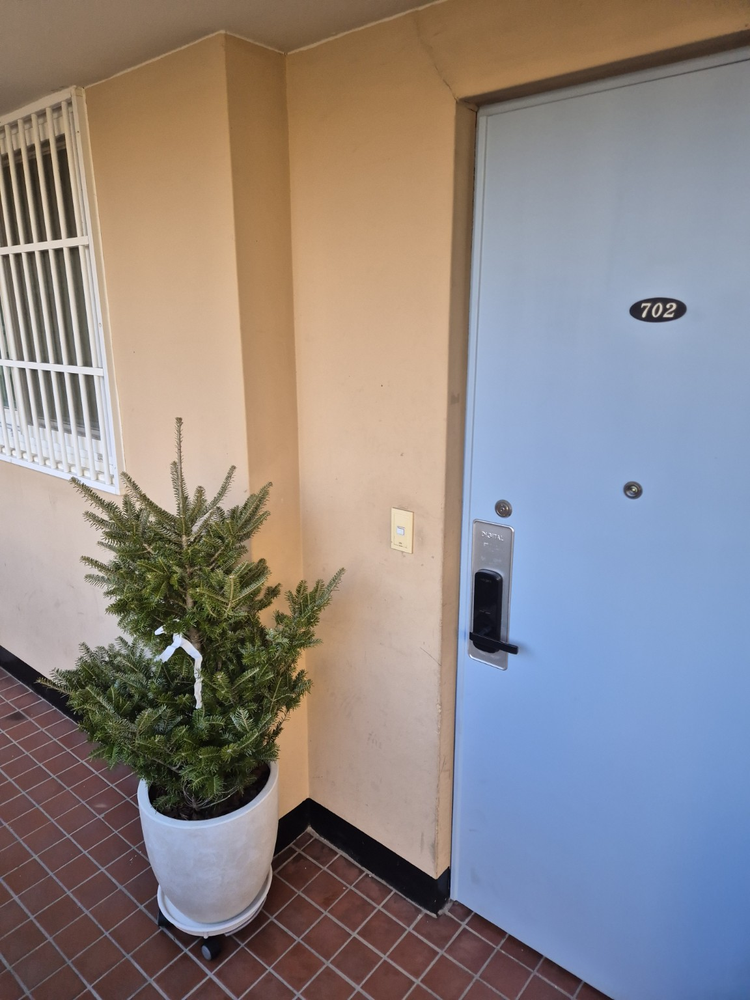
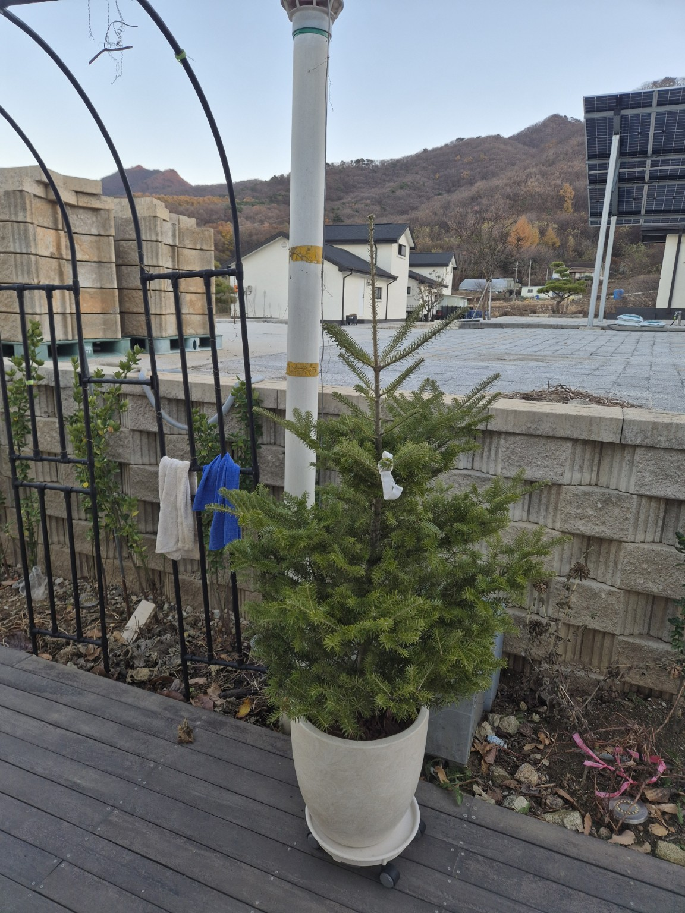
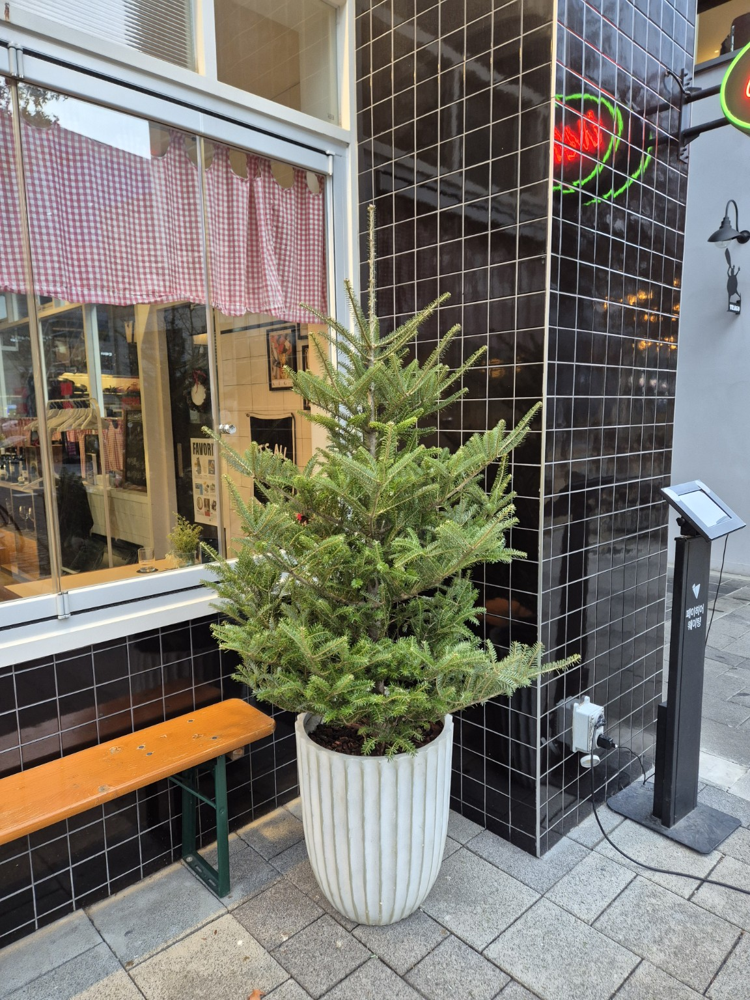
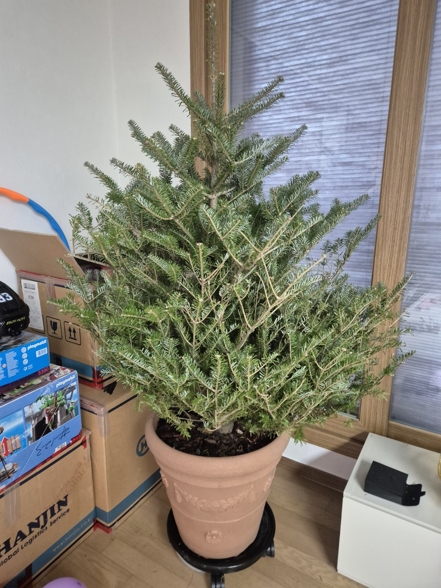
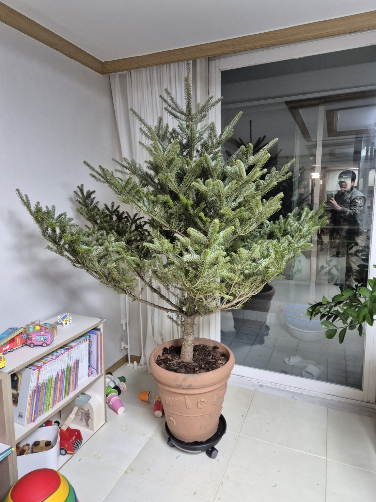

# 구상나무 배송·분갈이 절차서
신입 교육용 초안 v0.5 | 작성 2026-11-13 | 담당: 권석빈 대리
사용자 실무 설명을 정리했으며 미확정 규격·방법은 질문으로 남겼다. 제안사항은 확정 절차와 구분한다. Q&A는 추후 추가한다.

## 1. 출발 전 준비물
- 구상나무
- 화분, 화분 받침대
- 물조리개
- 화분 깔망
- 난석
- 상토
- 물티슈
- 큰 나무 운반용 끌개: 높이 2m 이상이면 준비(장비 종류·적재하중 확인 필요)

## 2. 크기별 자재 준비 기준
권석빈 대리의 현장 경험상 대략적인 준비량. 실제 소요량은 화분·뿌리분에 따라 달라질 수 있어 고정 배합비가 아니다. “개”는 원 보고 단위이며 포장 용량 미확정. 매장에 남아 있는 화분·자재에 따라 달라지므로 출발 전 대표님에게 그때그때 규격과 수량을 확인한다. 고정 L 단위나 높이별 화분 규격을 임의로 정하지 않는다.
| 나무 높이 | 상토 | 난석 | 운반 기준 |
|---|---:|---:|---|
| 약 120cm | 약 1개 | 약 0.3개 | 아래 운반 참고 |
| 약 150cm | 약 1.5개 | 약 0.4개 | 아래 운반 참고 |
| 약 180cm | 약 1.5개 | 약 0.4개 | 손으로 운반 가능하다는 현장 경험 |
| 약 200cm | 약 2개 | 약 1개 | 끌개 필요 |
| 약 250cm | 약 2.5개 | 약 1개 | 끌개 필요 |

사용자 실무 기준: 약 180cm는 혼자 들 수 있고, 2m 이상은 힘이 있는 작업자가 맡는 것을 권장한다. 2m 이상 끌개 준비 지침은 유지한다. 이는 모든 화분 무게와 계단 조건에서 단독 운반이 가능하다는 보장이 아니며, 신입은 실제 무게와 동선을 보고 지원 필요 여부를 담당자에게 확인한다.

## 3. 현장 도착·작업 위치
1. 엘리베이터 유무와 반입 동선을 확인한다.
2. 엘리베이터가 없으면 나무·화분·자재를 낱개로 나누어 고객의 동·호수 근처까지 옮긴다.
3. 고객과 위치를 정한 뒤 세대 근처의 넓은 복도에서 화분에 식재한다. 복도가 좁으면 세대 근처에서 통행을 확보하면서 작업할 수 있는 작은 공간을 사용한다.

## 4. 분갈이 순서
1. 화분 밑에 깔망을 놓는다.
2. 난석을 넣는다.
3. 구상나무와 상토를 넣어 식재한다. 정확한 식재 깊이·난석 두께·상토 채움 방법은 추가 교육이 필요하며 이 초안에서 임의 수치화하지 않는다.
4. 실내 지정 위치로 이동하여 화분 받침대 위에 놓는다.
5. 화분 옆면을 가볍게 두드리면서 물을 천천히 준다.
6. 물이 배수구로 빠지는 것을 확인한다. 배수가 확인되지 않은 상태에서 작업을 끝내지 않는다.
7. **배수가 안 되거나 이상이 있으면 권석빈 대리에게 보고한 뒤 현장에서 대기한다.** 지시를 받기 전 임의로 작업 완료 처리하거나 현장을 떠나지 않는다.
8. 받침대에 고인 물은 고객에게 “화장실이나 싱크대에 버려도 될까요?”라고 먼저 묻고, 고객이 안내한 장소와 방법으로 처리한다.
9. 물티슈 등으로 주변을 정리한다.
10. 고객에게 관리 요령과 직원을 통한 문의 전달 방식을 안내하고 완료 상태를 확인받는다. 개인 전화번호는 안내하지 않는다.
11. **작업 후 사진을 반드시 촬영해 업무 카톡방 또는 기록용 파일에 남긴다.** 배송·설치 완료 여부를 나중에 확인할 수 있도록 기록한다. 사진 한 장이 모든 인도 분쟁을 해결한다고 단정하지 않는다.

### 사진 촬영 예시와 식재 마무리 사진

나무 꼭대기와 양옆 가지 끝, 화분 바닥까지 한 화면에 담는다. 받침대를 사용한 경우 받침대도 함께 담아 설치 상태를 기록한다.

**현관 앞 설치 위치와 화분 받침대**

**야외 데크에서 촬영한 나무 전경과 받침대**

**매장 앞 식재를 마친 나무와 화분**

**실내 화분의 가지와 흙 표면**

**실내에 배치한 나무 전체와 바퀴 받침대**

## 5. 고객 관리 안내
### 사용자 설명을 정리한 내용
- 통풍과 햇빛을 확보하는 위치를 안내한다.
- 줄기 가까운 안쪽의 오래된 잎이 노랗게 변하며 떨어지는 것은 자연스러운 잎 교체일 수 있다.
- 가지 끝 잎의 탈락은 수분 부족·과습 등을 점검할 신호로 보고, 상태를 확인한다.
- 관수 후 물이 빠지는지 확인하는 이유와 배수 관리의 중요성을 설명한다.

### 신입 교육용 표현 보완
- “안쪽 잎이 노랗게 변하면 무조건 정상”이라고 단정하지 않는다. 오래된 안쪽 잎의 계절적 탈락은 자연스러울 수 있지만 범위·진행 양상을 함께 확인한다.
- “가지 끝 잎이 떨어지면 반드시 물 문제”라고 진단하지 않는다. 위치만으로 원인을 확정하지 않고 사진·토양 수분·배수·환경 정보를 담당자에게 전달한다.
- 구상나무의 기본 재배 조건은 햇빛과 촉촉하되 배수가 좋은 토양이다. 실내 납품이라는 이유로 장기간 실내 생육이 보장된다고 안내하지 않는다. 설치 환경·실내 유지 기간·냉난방 위치 기준은 추가 확인 필요.
### 물주기 — 사용자 경험상 참고 간격
- 여름: 보통 2~3일 간격, 겨울: 보통 2주 간격을 참고한다. 계절별 고정 일정으로 무조건 관수하라는 뜻으로 교육하지 않는다.
- 겨울에는 1~2주 간격으로 나무젓가락을 꽂아 흙 안쪽의 수분 상태를 확인한다.
- **만져봤을 때 습기가 느껴진다면 물줄 시기가 아니다.** 물을 주지 않고 이후 수분 상태를 다시 확인한다. 계절별 참고 간격보다 실제 수분 상태를 우선한다.
- 첫 관수량 및 배수 확인 대기시간은 미확정.

## 6. 고객 응대(CS)
- 수형·상태가 마음에 들지 않는다는 의견을 먼저 충분히 듣는다.
- 어떤 부분이 불편한지 구체적으로 확인하고 담당자에게 전달한다.
- 교환·환불·추가 전정 등은 신입이 임의 약속하지 않는 방안을 제안하며, 회사 처리 기준은 추후 확정한다.
- **고객에게 개인 전화번호를 알려주거나 안내하지 않는다.** 고객 문의는 직원을 통한 연락망으로 접수·전달한다. 직원은 내부 연락망으로 담당자에게 보고한다.
- 고객 안내 예: “수형이나 나무 상태 등 궁금하거나 불편한 점이 있으시면 직원에게 말씀해 주세요. 직원 연락망을 통해 담당자에게 전달하겠습니다.”

## 7. 추가하면 좋은 점 — 제안, 미확정
- 배송 전 화분·받침대·나무 높이와 고객 주문을 대조한다.
- 출고 전 사진 기록도 추가하면 좋다. 설치 후 사진 촬영·업무 카톡방 또는 파일 보관은 사용자 필수 지침으로 확정했다.
- 차량 안 고정 방법, 가지·뿌리분 보호, 엘리베이터·출입문 치수, 바닥 보양 방법을 표준화한다.
- 배수 이상 시 보고 후 대기는 확정 절차(4절 참조). 받침대 잔수는 고객에게 처리 위치를 묻는다.
- 작업 완료 확인표에 배수 확인·주변 정리·고객 설명·사진 기록 항목을 둔다.

## 8. 남은 확인 질문
### 확인 완료
1. 만져봤을 때 습기가 느껴지면 물줄 시기가 아니므로 관수하지 않는다.
2. 배수가 안 되거나 이상하면 보고 후 대기한다.
위 두 항목은 2026-11-13 사용자 확인으로 확정.

### 추후 교육 보완
- 높이는 화분 제외 나무 높이인지, 깔망 범위·난석 두께·식재 깊이.
- 끌개 종류·하중·차량 고정 방법, 180~200cm 중간 크기와 계단에서 지원 인원 판단.
- 첫 관수량·배수 확인 대기시간, 실내 설치 환경·유지 기간.
- 수형 변경·교환 요청에서 신입이 결정할 수 있는 범위.

변경 이력

- v0.5 (2026-11-19) — 120·150·180cm 자재 준비량과 엘리베이터가 없는 현장의 식재 위치를 반영했다.
- v0.4: 사용자 지시에 따라 본문 개인 전화번호 삭제. 고객에게 번호를 제공하지 않고 직원 연락망을 통해 문의를 전달하는 방식으로 변경.
- v0.3: 습기가 느껴지면 관수하지 않음, 배수 불량·이상 발생 시 보고 후 대기를 확정 지침으로 반영.
- v0.2: 자재 규격은 매번 대표 확인, 화분 옆면 가볍게 두드리기, 무엘리베이터 현장 낱개 운반·실내/복도 작업, 고객 동의 후 잔수 처리, 크기별 운반 경험 기준, 계절별 참고 관수 간격, 작업 후 사진 필수 기록 반영.
- 고객 응대는 최신 지침을 따른다. 개인 전화번호를 고객에게 제공하지 않고 직원을 통한 연락망으로 전달한다. Q&A는 계속 보완한다.

참고 자료

현장 자재량의 출처는 사용자 설명이다. 아래 자료는 식물 상태 안내의 단정 표현을 보완하기 위해 참고했다.
- RHS, Abies koreana: https://www.rhs.org.uk/plants/44/abies-koreana/details
- Iowa State University Extension, Seasonal Needle Loss: https://yardandgarden.extension.iastate.edu/encyclopedia/seasonal-needle-loss
- University of Minnesota Extension, Fir needles drop prematurely: https://apps.extension.umn.edu/garden/diagnose/plant/evergreen/fir/needlesdrop.html

